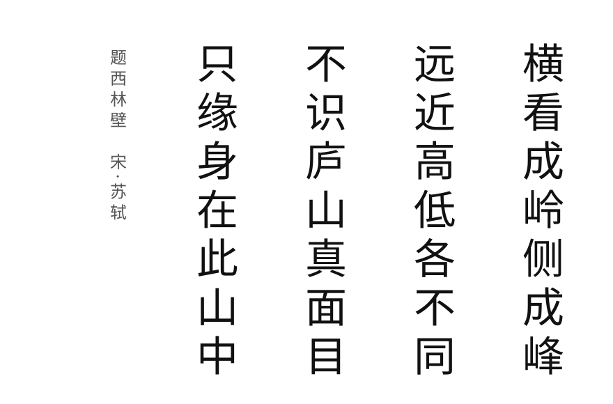

<p align="center">
  
</p>

<p align="center"><sub>Viewed from across, a ridge; from the side, a peak — far, near, high, low, never the same.<br>You cannot know the true face of Mount Lu, only because you are within the mountain.<br>— Su Shi, <i>Written on the Wall of Xilin Temple</i></sub></p>

<p align="center"><a href="README.md">简体中文</a> · <b>English</b></p>

<h1 align="center">HACHIMI-II</h1>

<p align="center">
  A meta-method repository for <b>student simulation</b>, using third-person state modeling to fight large-model <i>competence leakage</i>.
</p>

<p align="center">
  <a href="#quick-start"></a>
  <a href="#datasets--tasks"></a>
  <a href="#what-the-method-deliberately-avoids"></a>
  <a href="LICENSE"></a>
</p>

---

## What this is

When you simply ask a large model to "play a student" and answer items or hold a dialogue, it tends to produce how **it** would answer — accurate, fluent, almost never making the mistakes a real student makes. The simulated "student" reproduces neither the real student's ability level nor the structure of their errors. We call this **competence leakage**.

HACHIMI-II is not a set of disjoint per-dataset scripts. It is **one unified student-simulation meta-method**, whose core claim is:

> **First model the learner as a state in the third person, then generate the current single step of learner behavior within the boundaries of that state.**

See the contour of "Mount Lu" from outside the mountain first, then step back in to place a single stroke — instead of being "within the mountain" from the start.

It is instantiated on two task families:

- **Static simulation**: single-item, single-step student answering (mathematics and natural science);
- **Dynamic simulation**: multi-turn, step-by-step tutoring dialogue.

---

## Key results

Across 5 datasets, HACHIMI-II simultaneously suppresses competence leakage and reproduces the structure of real student errors (all metrics recomputed from per-sample records).

**Static item answering** — highest correctness agreement, smallest per-student accuracy-distribution distance (W₁), highest student-ordering correlation:

| Dataset | Agree ↑ | W₁ ↓ | Student ρ ↑ | strongest baseline W₁ |
|---|---|---|---|---|
| XES3G5M | **0.752** | **0.039** | **0.691** | 0.327 |
| Eedi | **0.606** | **0.046** | **0.703** | 0.119 |
| ENEM | **0.630** | **0.169** | **0.668** | 0.409 |

> Baseline simulated accuracy tracks the model's own competence, not the real students: on ENEM the real mean is ~0.39 while baselines simulate ~0.82; on XES3G5M the real mean is ~0.83 while baselines simulate ~0.50. HACHIMI-II stays close to the real level (ENEM 0.384, XES3G5M 0.828).

**Dynamic tutoring dialogue** — realized error-structure recall (SRec) several times that of the strongest baseline:

| Dataset | SRec ↑ (HACHIMI-II) | strongest baseline SRec |
|---|---|---|
| Eedi QATD2k | **0.399** | ≤ 0.180 |
| Khan/CoMTA | **0.649** | ≤ 0.113 |

> Full functional-agreement (κ_func / MCC_func), error-state (BAcc_err / MCC_err), calibration (Calib), and the three ablations (removing the persona prior / task-local state / behavior harness) are reported in the paper and its appendix.

---

## Datasets & tasks

| Modality | Directory | Dataset | Task |
|---|---|---|---|
| static | `static/xes/` | XES3G5M | math item-answering simulation |
| static | `static/eedi-static/` | Eedi | math diagnostic-item simulation |
| static | `static/enem/` | ENEM | natural-science cross-subject answering |
| dynamic | `dynamic/eedi/` | Eedi / QATD2k | turn-by-turn tutoring-dialogue simulation |
| dynamic | `dynamic/khan/` | Khan / CoMTA | tutoring-dialogue transfer experiment |

---

## Quick start

```bash
git clone https://github.com/ZeroLoss-Lab/HACHIMII-YL.git
cd HACHIMII-YL
pip install -r requirements.txt   # core harness needs only the stdlib; sub-projects add deps as needed
```

Each dataset ships its own entry point, config, and reports. For example:

```bash
# static: XES3G5M student-answering simulation
python static/xes/run_experiments.py

# static: ENEM natural science
python static/enem/run_enem_static_benchmark.py

# dynamic: Eedi / QATD2k tutoring dialogue
python dynamic/eedi/run_eedi_experiments.py

# dynamic: Khan / CoMTA
python dynamic/khan/run_khan_experiments.py
```

> Generation requires an OpenAI-compatible LLM endpoint (set via each script's `--llm_base_url` / `--llm_model` / `--llm_api_key`). Run any entry point with `--help` for full arguments.

---

## Repository structure

```text
static/
  xes/           # XES3G5M  static math item-response simulation
  eedi-static/   # Eedi     static math diagnostic-item simulation
  enem/          # ENEM     natural-science static cross-subject simulation
  baselines/     # static baselines (Direct RP / Prompt-C / Profile-C)

dynamic/
  eedi/          # Eedi / QATD2k  dynamic tutoring-dialogue simulation
  khan/          # Khan / CoMTA   dynamic tutoring-dialogue transfer experiment
  baselines/     # dynamic baselines (+ Agent-Mem)

reports/         # experiment reports & result summaries
figures/         # figures and assets
```

Principles: `static/` and `dynamic/` are separated by simulation modality; each dataset keeps its own entry point, config, reports, and source; no top-level unifying wrapper; raw data, caches, and experiment outputs stay out of Git.

---

## The shared meta-method interface

Every instantiation shares one skeleton:

```
Learner Context → Task / Interaction Context → Learner-Task Fit
                → State Layer → Harness / Constraint → Surface Realization
```

| Stage | Meaning |
|---|---|
| `Learner Context` | who this learner is |
| `Task / Interaction Context` | what the current task or dialogue turn is |
| `Learner-Task Fit` | how this learner fares against this task |
| `State Layer` | the third-person state judgment made before generation |
| `Harness / Constraint` | translating the state into generation boundaries |
| `Surface Realization` | the current single step of learner behavior |

When porting to a new task, **do not start by writing prompts**: first fix what information each slot needs, then fill it with the educational theory specific to that task.

---

## Documentation

| Document | Content |
|---|---|
| [`META_METHOD_GUIDE.md`](META_METHOD_GUIDE.md) | meta-method overview |
| [`STATIC_SIMULATION_GUIDE.md`](STATIC_SIMULATION_GUIDE.md) | static simulation method |
| [`DYNAMIC_SIMULATION_GUIDE.md`](DYNAMIC_SIMULATION_GUIDE.md) | dynamic simulation method |
| [`AGENT_META_METHOD_PLAYBOOK.md`](AGENT_META_METHOD_PLAYBOOK.md) | Codex / agent porting playbook |
| [`DATASET_EXPANSION_PLAN.md`](DATASET_EXPANSION_PLAN.md) | multi-dataset expansion plan |
| [`PROJECT_GUIDE.md`](PROJECT_GUIDE.md) | project scope and boundaries |

---

## What the method deliberately avoids

Explicitly **out of scope**:

- no direct role-play of the student;
- no skipping the third-person state layer;
- no putting real labels, future replies, or official evaluation annotations into the generation chain;
- no special-casing by item id or student id;
- no post-hoc editing of answers;
- no piling on "make it more student-like" prompt patches to fake results.

---

## The parable of Mount Lu

> Viewed from across, a ridge; from the side, a peak —
> far, near, high, low, never the same.
> You cannot know the true face of Mount Lu,
> only because you are within the mountain.

This poem is the methodological metaphor of HACHIMI-II.

- **A ridge from across, a peak from the side; far, near, high, low, never the same.** The same student looks different from different viewpoints — item answering is one facet, tutoring dialogue is another; ability level, error structure, and knowledge mastery each form their own "peak." Any single view is only a fragment.
- **You cannot know the true face of Mount Lu, only because you are within the mountain.** Asking a model to role-play the student in the first person *is* being "within the mountain": the model is trapped in its own competence and viewpoint, generating its own shadow (competence leakage) and never seeing the student's true face.

HACHIMI-II's move is to step out of the mountain first: **model the student as a state in the third person**, sketching the boundary contour of "Mount Lu" from the outside — and only then step back in to generate this single step of behavior within that boundary. Know the true face first; then place each ridge and peak.

---

## Citation

If this repository helps your research, please cite it (paper details to follow):

```bibtex
@misc{hachimi2,
  title  = {HACHIMI-II: Third-Person State Modeling for Student Simulation},
  author = {ZeroLoss Lab},
  year   = {2026},
  note   = {https://github.com/ZeroLoss-Lab/HACHIMII-YL}
}
```

## License

Released under the [MIT License](LICENSE).
